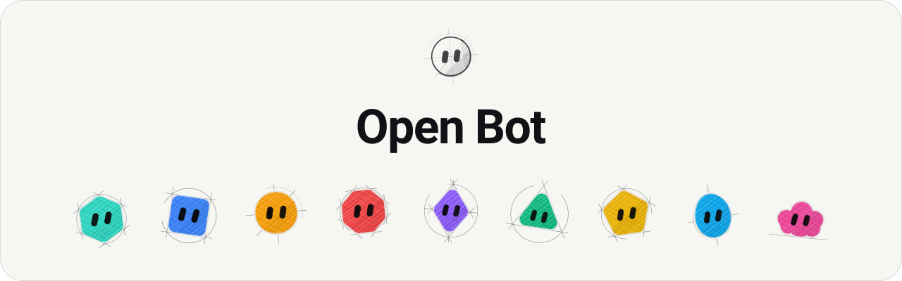
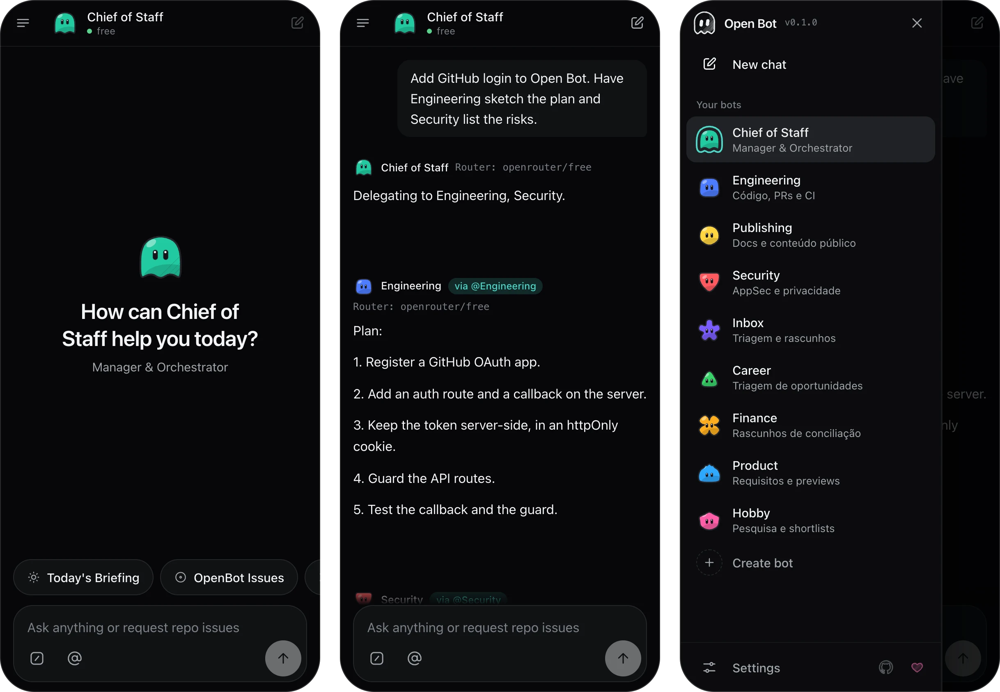
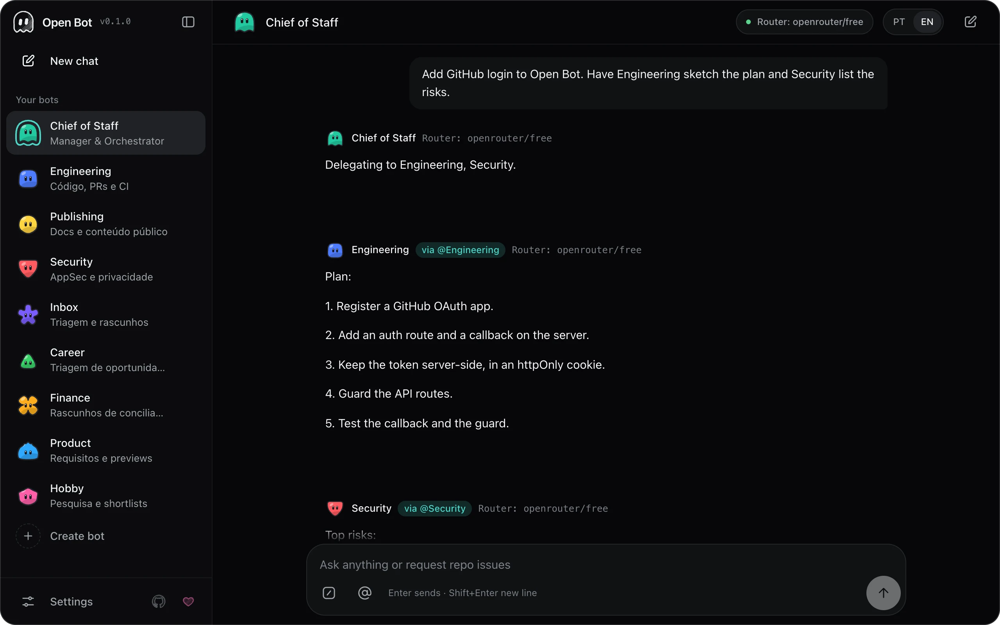

<picture>
  <source media="(prefers-color-scheme: dark)" srcset="docs/assets/readme/banner-dark.svg">
  
</picture>

# Open Bot

> Un equipo de bots de IA que vive en tu celular. Un Chief of Staff lidera y delega, tú eliges el modelo y tus claves de API se quedan en tu propio servidor.

[English](README.md) · [Português](README.pt-BR.md) · [Primeros pasos](#primeros-pasos) · [Pantallas](#cómo-se-ve) · [El equipo](#el-equipo) · [Modelos](#elige-un-modelo) · [Instálalo en tu celular](#instálalo-en-tu-celular) · [Estado](#estado-y-límites)

<picture>
  <source media="(prefers-color-scheme: dark)" srcset="docs/assets/readme/architecture-dark.svg">
  
</picture>

La app en tu navegador habla solo con tu servidor. El servidor guarda las claves y llama al modelo y a GitHub.

## Primeros pasos

1. Selecciona Node.js 24 desde `.nvmrc` con `nvm use` (Node.js 24.15.0 o superior, la línea LTS con el módulo SQLite integrado).
2. Instala las dependencias y los hooks de Git con `npm ci`.
3. Copia `.env.example` a `.env.local` y completa un proveedor. Puedes omitir este paso y elegir un modelo después, en Configuración.
4. Ejecuta `npm run dev` y abre `http://localhost:3000`.

## Cómo se ve

En un celular, la lista de bots es un panel deslizable y el campo de mensaje queda al alcance del pulgar. Desde el ancho de una tableta se convierte en una barra lateral que puedes contraer.

## El equipo

Cada bot tiene su propia conversación, prompt, avatar y skills. Cambiar de bot cambia el chat, y cada historial se queda en este dispositivo. Escribe `@` para pasar un mensaje a otro bot y `/` para ejecutar una de tus skills.

Open Bot arranca con un equipo de nueve. Todos los prompts del equipo piden tu aprobación explícita antes de cualquier cambio externo.

| Bot            | Se encarga de                                                        |
| -------------- | -------------------------------------------------------------------- |
| Chief of Staff | Planifica, resume y delega en los demás. El bot principal al inicio. |
| Engineering    | Código, pull requests y CI                                           |
| Publishing     | Documentación y contenido público                                    |
| Security       | AppSec y privacidad                                                  |
| Inbox          | Clasificación de mensajes y borradores                               |
| Career         | Clasificación de oportunidades                                       |
| Finance        | Borradores de conciliación                                           |
| Product        | Requisitos y vistas previas                                          |
| Hobby          | Investigación y listas comparativas                                  |

Puedes editar cualquiera de ellos o crear los tuyos, desde un formulario en blanco o desde una plantilla: Architect, Code Reviewer, AppSec Lead, Platform Engineer, Technical Writer o Bug Hunter.

### El bot principal lidera

Un bot es el principal. Hace el papel de Chief of Staff: va arriba de la lista, conoce a todos los demás bots y no se puede eliminar. Cualquier bot puede asumir el papel: ábrelo, elige Hacer principal y el equipo lo sigue. Nada del equipo es fijo. El Chief lee los bots que tienes, sus funciones y sus skills cada vez que envías un mensaje.

### Cómo funciona la delegación

<picture>
  <source media="(prefers-color-scheme: dark)" srcset="docs/assets/readme/delegation-dark.svg">
  
</picture>

Pídele al Chief algo que requiera a más de un especialista y escribirá una línea `@delegate` por tarea. Cada especialista responde por turno, con su propio nombre y avatar, y luego el Chief escribe un solo resumen para ti.

- Como máximo tres delegaciones por turno, respondidas una tras otra, para no saturar los niveles gratuitos de los modelos.
- Un solo salto. Un especialista nunca vuelve a delegar, así que no hay bucles.
- Se descartan los nombres que el Chief inventa, a sí mismo y las repeticiones. Un especialista que falla no rompe el turno.
- Igual puedes hablar directamente con cualquier bot, o pasarle un solo mensaje con `@`.

## Qué hace hoy

| Capacidad              | Cómo funciona                                                                                                                                                                                                                                 |
| ---------------------- | --------------------------------------------------------------------------------------------------------------------------------------------------------------------------------------------------------------------------------------------- |
| Chat con un modelo     | El servidor llama al proveedor que configuraste. Consulta [Elige un modelo](#elige-un-modelo).                                                                                                                                                |
| Issues y PRs de GitHub | Pide `owner/repo` o pega un enlace de GitHub. Los repositorios públicos funcionan sin token. Para los privados, conecta GitHub en Configuración, en Conexiones, o define `GITHUB_TOKEN` en `.env.local`.                                      |
| Resumen (briefing)     | Resume datos reales del repositorio. Sin modelo, arma un resumen con esos mismos datos.                                                                                                                                                       |
| Delegación             | El bot principal pasa trabajo a tus otros bots y trae un solo resumen. Consulta [Cómo funciona la delegación](#cómo-funciona-la-delegación).                                                                                                  |
| Failover               | Cuando falla el modelo del router, el servidor reintenta una vez con un modelo de respaldo, por defecto un modelo gratuito de OpenRouter, y la respuesta muestra el cambio.                                                                   |
| Cola de mensajes       | Los mensajes que envías mientras un bot responde esperan su turno, en orden.                                                                                                                                                                  |
| Skills                 | Cada bot tiene sus propias skills. Escribe una al editar el bot, o pega un `SKILL.md`, y ejecútala como un `/comando`.                                                                                                                        |
| Bot como archivo       | Exporta un bot a un archivo JSON con su nombre, instrucciones, aspecto y skills, y rellena el formulario de un bot nuevo a partir de uno. El archivo no lleva chats, claves ni contraseña, y las skills importadas se marcan como importadas. |
| Bloqueo local          | Contraseña opcional que bloquea la app en este dispositivo. Es un bloqueo de pantalla, no autenticación; solo se guarda un hash PBKDF2.                                                                                                       |
| Tres idiomas           | Portugués de Brasil, inglés y español, que se cambian en cualquier momento.                                                                                                                                                                   |

## Elige un modelo

| Proveedor | Variables en `.env.local`                               | Notas                                                                                                                                                                   |
| --------- | ------------------------------------------------------- | ----------------------------------------------------------------------------------------------------------------------------------------------------------------------- |
| Router    | `ROUTER_URL`, `ROUTER_MODEL`, opcional `ROUTER_API_KEY` | Cualquier endpoint compatible con OpenAI, como OpenRouter, 9Router u OmniRoute. Configuración lista los modelos gratuitos de OpenRouter que tu propia clave puede usar. |
| Local     | `LOCAL_MODEL_URL`, `LOCAL_MODEL_NAME`                   | Un servidor `/api/chat` compatible con Ollama que ejecutas tú.                                                                                                          |
| Anthropic | `ANTHROPIC_API_KEY`, `ANTHROPIC_MODEL`                  | Uso de API de pago.                                                                                                                                                     |

Las variables de `.env.local` se quedan en el servidor. Nunca les pongas el prefijo `NEXT_PUBLIC_`, porque eso las enviaría al navegador.

Cada bot también puede llevar su propio id de modelo (en el formulario de edición del bot; vacío significa el modelo global). El servidor puede limitar qué ids se aceptan:

| Variable                 | Efecto                                                                                                                                                             |
| ------------------------ | ------------------------------------------------------------------------------------------------------------------------------------------------------------------ |
| `OPENBOT_ALLOWED_MODELS` | Opcional, separada por comas. Si está definida, un id de modelo de un bot fuera de la lista recibe `400 model_not_allowed`. Si no, pasa cualquier id bien formado. |

También puedes elegir el proveedor en Configuración, en Modelo. Las claves van en Conexiones: cada servicio tiene su propia clave, probada antes de guardarse. Esa elección reemplaza a `.env.local`. Se guarda en el `localStorage` de este navegador y viaja a tu propio servidor con cada mensaje, así que usa `.env.local` para las claves en un dispositivo compartido.

## Instálalo en tu celular

1. Compila y sirve la app de producción: `npm run build` y luego `npm start`. El service worker solo se registra en una compilación de producción.
2. Ábrela en el celular por HTTPS. Los navegadores solo instalan apps desde HTTPS o desde `localhost` en la misma máquina.
3. En iPhone, ábrela en Safari y elige Compartir, luego Agregar a pantalla de inicio. En Android, ábrela en Chrome y elige Instalar app en el menú.

`npm run dev` y `npm start` escuchan solo en esta máquina (`127.0.0.1`), así que el celular llega a la app por un proxy inverso o túnel HTTPS que corre aquí. Para que otros dispositivos se conecten directo al servidor, define `OPENBOT_ACCESS_TOKEN` y ejecuta `npm start -- -H 0.0.0.0`.

El service worker guarda en caché solo el armazón de la app. Nunca guarda en caché las llamadas a `/api`, las respuestas del modelo ni las credenciales.

Por defecto el servidor no tiene inicio de sesión, lo cual está bien en localhost. Cada llamada a `/api` se valida con un `Origin` del mismo sitio (o el encabezado `x-openbot-client: 1`), se limita a 64 KB y a 60 solicitudes por minuto por cliente (`OPENBOT_RATE_LIMIT`). Sin token, la API solo atiende llamadas de loopback (`127.0.0.1`, `::1`); una solicitud de cualquier otro dispositivo se rechaza con `403 access_token_required`, así el servidor nunca queda abierto a tu red por accidente. Para usarlo desde otro dispositivo o exponerlo fuera de tu máquina, define `OPENBOT_ACCESS_TOKEN` en `.env.local`: entonces cada llamada a `/api` necesita `Authorization: Bearer <token>`. En el navegador, guarda el token una vez con `localStorage.setItem("openbot_access_token", "<token>")` en la consola de desarrollo. Mantenlo detrás de HTTPS y de un control de acceso en el que confíes.

Estas variables ajustan la protección de `/api`. Defínelas en `.env.local`:

| Variable                     | Efecto                                                                                                                                                                                                                                                                                                                                                                                                                                                                                                           |
| ---------------------------- | ---------------------------------------------------------------------------------------------------------------------------------------------------------------------------------------------------------------------------------------------------------------------------------------------------------------------------------------------------------------------------------------------------------------------------------------------------------------------------------------------------------------- |
| `OPENBOT_RATE_LIMIT`         | Solicitudes por minuto por cliente (por defecto 60).                                                                                                                                                                                                                                                                                                                                                                                                                                                             |
| `OPENBOT_TRUST_PROXY`        | Defínela en `1` solo detrás de un proxy inverso que controles, que siempre establezca o agregue `X-Forwarded-For` y sea la única vía de entrada. El cliente es entonces el último salto de ese encabezado. Sin definir (por defecto), todos los clientes comparten un solo bucket de límite de solicitudes y un solo conjunto de cupos de stream, porque Next no expone una dirección de origen que el cliente no pueda falsificar. Está bien para una persona, pero es demasiado estricto para muchos usuarios. |
| `OPENBOT_STREAMS_PER_CLIENT` | Respuestas en streaming que un cliente puede tener abiertas a la vez (por defecto 4). Pasado ese número, `/api/chat/stream` responde `429 too_many_streams`.                                                                                                                                                                                                                                                                                                                                                     |
| `OPENBOT_STREAMS_GLOBAL`     | Respuestas en streaming abiertas a la vez en todo el servidor (por defecto 20).                                                                                                                                                                                                                                                                                                                                                                                                                                  |

Una sola respuesta también tiene un tope de 200.000 caracteres. Pasado ese límite se corta y el chat lo indica.

## Estado y límites

Open Bot es un proyecto en etapa temprana, en la versión 0.1.0.

- Las pruebas automatizadas usan proveedores simulados. Ninguna prueba se ejecuta contra un modelo real.
- Aún no se verificó la instalación en un iPhone ni en un dispositivo Android físico.
- Los bots, chats, skills y la configuración viven en el `localStorage` de este navegador. No hay sincronización, pero puedes exportar e importar un archivo de copia de seguridad en Configuración (no incluye claves, tokens ni contraseñas).
- Las descripciones del equipo siguen solo en portugués, incluso con la interfaz en inglés o en español.
- La delegación solo se ejecutó a mano contra un modelo gratuito. Ninguna prueba automatizada llama a un modelo real.
- Todavía no existe integración con calendarios.

La [hoja de ruta](docs/roadmap/README.md) y el [plan para desarrolladores](docs/roadmap/developer-first.md) enumeran lo que viene.

## Desarrollo

`npm ci` instala los hooks de Husky. El pre-commit da formato y lintea los archivos en staging. El pre-push y el CI ejecutan `npm run check`: verificación de documentos, Prettier, ESLint, `tsc`, pruebas y la compilación de producción. Lee [CONTRIBUTING.md](CONTRIBUTING.md) antes de abrir un pull request.

| Lectura                                        | Para                                                                 |
| ---------------------------------------------- | -------------------------------------------------------------------- |
| [Arquitectura](docs/architecture/README.md)    | Capas, la Regla de Dependencia, puertas de entrega y alcance del MVP |
| [Candidatos de stack](docs/stacks/README.md)   | El primer spike y la decisión del kit de UI                          |
| [DESIGN.md](DESIGN.md)                         | Color, tipografía, áreas táctiles, movimiento y voz                  |
| [Harness](docs/harness/README.md)              | Guías, sensores y límites de los agentes                             |
| [Convenciones de Git](docs/git-conventions.md) | Commits, ramas y pull requests                                       |

## Por qué Open Bot

Open Bot nació de un dolor conocido: Grok Bot era demasiado caro para un brasileño sin dinero que quería un agente personal. El objetivo es algo accesible, abierto a contribuciones y gratuito de ejecutar con un modelo local o con la clave de un proveedor que tú elijas. Se inspira en [grok-bot-architecture](https://github.com/tiagovilasboas/grok-bot-architecture) para los roles, los límites y los patrones de aprobación.

## Lo que este repositorio no incluye

- Una instancia alojada ni registro de usuarios. Tú ejecutas tu propio servidor.
- Modelos ni claves de API. Tú traes los tuyos.
- Sincronización entre dispositivos.
- Ninguna afiliación con Grok Bot. Open Bot es un proyecto independiente.

## Licencia

Open Bot es de código abierto bajo la [licencia MIT](LICENSE).

## Apoya el proyecto

Open Bot lo mantiene Tiago Vilas Boas. Si quieres apoyar su desarrollo, [patrocina en GitHub](https://github.com/sponsors/tiagovilasboas). El patrocinio es opcional; las contribuciones, los comentarios y los reportes de errores también son bienvenidos.
