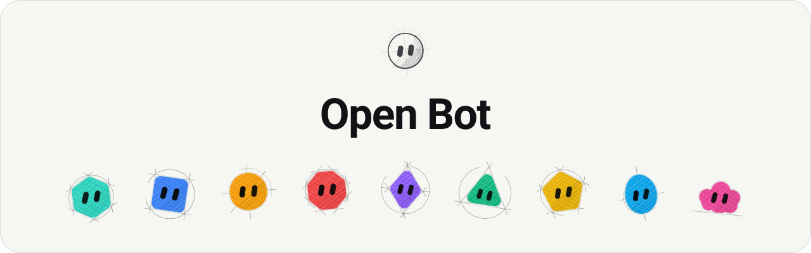
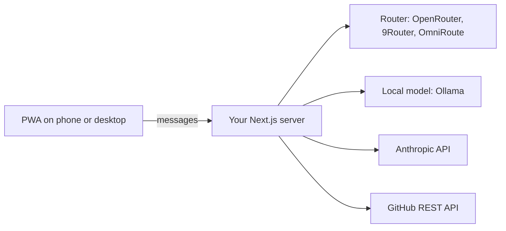
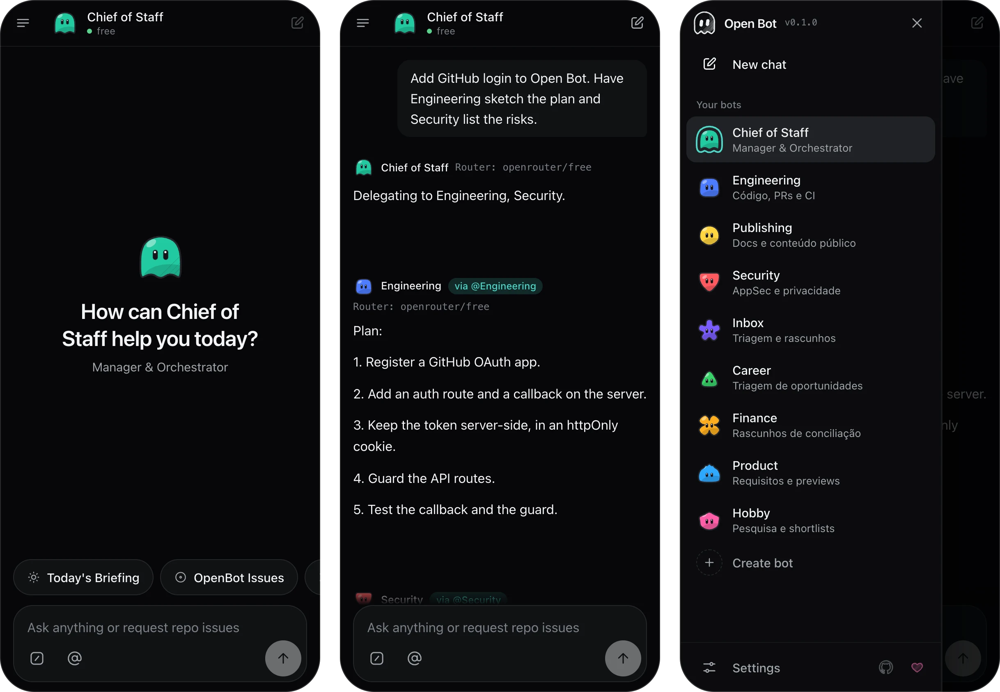
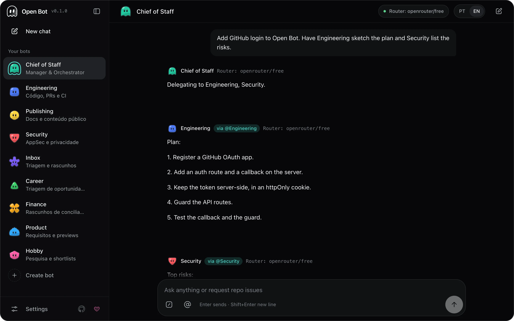
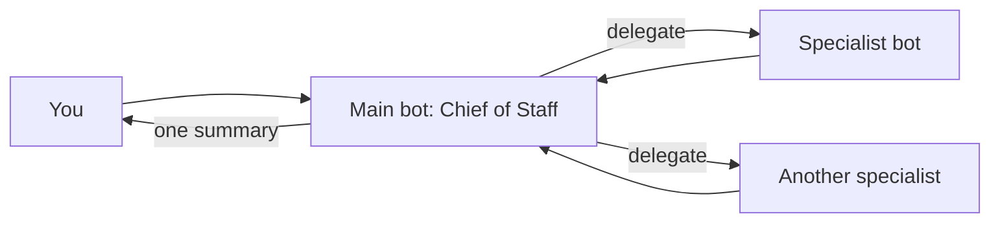

<picture>
  <source media="(prefers-color-scheme: dark)" srcset="docs/assets/readme/banner-dark.svg">
  
</picture>

# Open Bot

> A crew of AI bots that lives on your phone. A Chief of Staff leads and delegates, you pick the model, and your API keys stay on your own server.

[Português](README.pt-BR.md) · [Getting started](#getting-started) · [Screens](#what-it-looks-like) · [The crew](#the-crew) · [Models](#choose-a-model) · [Install on your phone](#install-on-your-phone) · [Status](#status-and-limits)

The app in your browser talks only to your server. The server holds the keys and calls the model and GitHub.

## Getting started

1. Select Node.js 22 from `.nvmrc` with `nvm use` (Node.js 22.6.0 or newer).
2. Install dependencies and Git hooks with `npm ci`.
3. Copy `.env.example` to `.env.local` and fill in one provider. You can skip this and choose a model in Settings later.
4. Run `npm run dev` and open `http://localhost:3000`.

## What it looks like

On a phone the bot list is a drawer and the composer sits in reach of your thumb. From tablet width up it becomes a sidebar you can collapse.

## The crew

Each bot has its own conversation, prompt, avatar and skills. Switching bots switches the chat, and each history stays on this device. Type `@` to hand a message to another bot, and `/` to run one of your skills.

Open Bot starts with a crew of nine. Every crew prompt asks for your explicit approval before any external change.

| Bot            | Handles                                                               |
| -------------- | --------------------------------------------------------------------- |
| Chief of Staff | Plans, summarizes and delegates to the others. The main bot at start. |
| Engineering    | Code, pull requests and CI                                            |
| Publishing     | Docs and public content                                               |
| Security       | AppSec and privacy                                                    |
| Inbox          | Triage and drafts                                                     |
| Career         | Opportunity triage                                                    |
| Finance        | Reconciliation drafts                                                 |
| Product        | Requirements and previews                                             |
| Hobby          | Research and shortlists                                               |

You can edit any of them or create your own, from a blank form or from a template: Architect, Code Reviewer, AppSec Lead, Platform Engineer, Technical Writer or Bug Hunter.

### The main bot leads

One bot is the main bot. It plays the Chief of Staff: it sits on top of the list, knows every other bot, and cannot be deleted. Any bot can take the role: open it, choose Make main, and the crew follows it. Nothing about the crew is fixed. The Chief reads the bots you have, their roles and their skills, every time you send a message.

### How delegation works

Ask the Chief for something that needs more than one specialist and it writes one `@delegate` line per task. Each specialist answers in turn, under its own name and avatar, then the Chief writes one summary for you.

- At most three delegations per turn, answered one after another, so free model tiers are not flooded.
- One hop only. A specialist never delegates again, so there are no loops.
- Names the Chief invents, itself, and repeats are dropped. A specialist that fails does not break the turn.
- You can still talk to any bot directly, or hand a single message over with `@`.

## What it does today

| Capability            | How it works                                                                                                                                                                                   |
| --------------------- | ---------------------------------------------------------------------------------------------------------------------------------------------------------------------------------------------- |
| Chat with a model     | The server calls the provider you configured. See [Choose a model](#choose-a-model).                                                                                                           |
| GitHub issues and PRs | Ask for `owner/repo` or paste a GitHub link. Public repositories work without a token. For private ones, connect GitHub in Settings, under Connections, or set `GITHUB_TOKEN` in `.env.local`. |
| Briefing              | Summarizes real repository data. Without a model, it falls back to a summary built from the same data.                                                                                         |
| Delegation            | The main bot hands work to your other bots and brings back one summary. See [How delegation works](#how-delegation-works).                                                                     |
| Failover              | When the router model fails, the server retries once on a fallback model, by default a free OpenRouter model, and the reply shows the switch.                                                  |
| Message queue         | Messages you send while a bot is replying wait their turn, in order.                                                                                                                           |
| Skills                | Each bot keeps its own skills. Write one when you edit the bot, or paste a `SKILL.md`, and run it as a `/command`.                                                                             |
| Local lock            | Optional password that locks the app on this device. It is hashed with PBKDF2 in the browser.                                                                                                  |
| Two languages         | Brazilian Portuguese and English, switchable at any time.                                                                                                                                      |

## Choose a model

| Provider  | Variables in `.env.local`                               | Notes                                                                                                                                     |
| --------- | ------------------------------------------------------- | ----------------------------------------------------------------------------------------------------------------------------------------- |
| Router    | `ROUTER_URL`, `ROUTER_MODEL`, optional `ROUTER_API_KEY` | Any OpenAI-compatible endpoint, such as OpenRouter, 9Router or OmniRoute. Settings lists the free OpenRouter models your own key can use. |
| Local     | `LOCAL_MODEL_URL`, `LOCAL_MODEL_NAME`                   | An Ollama-compatible `/api/chat` server that you run.                                                                                     |
| Anthropic | `ANTHROPIC_API_KEY`, `ANTHROPIC_MODEL`                  | Paid API usage.                                                                                                                           |

Variables in `.env.local` stay on the server. Never prefix them with `NEXT_PUBLIC_`, which would ship them to the browser.

You can also choose the provider in Settings, under Model. Keys go under Connections: each service has its own key, tested before it is saved. That choice overrides `.env.local`. It is saved in this browser's `localStorage` and travels to your own server with each message, so prefer `.env.local` for keys on a shared device.

## Install on your phone

1. Build and serve the production app: `npm run build`, then `npm start`. The service worker only registers in a production build.
2. Open it on the phone over HTTPS. Browsers install apps only from HTTPS, or from `localhost` on the same machine.
3. On iPhone, open it in Safari and choose Share, then Add to Home Screen. On Android, open it in Chrome and choose Install app from the menu.

The service worker caches the app shell only. It never caches `/api` calls, model replies or credentials.

The server has no login. Anyone who can reach its address can use the keys in `.env.local`, so keep it on your machine or behind access control you trust.

## Status and limits

Open Bot is an early project, at version 0.1.0.

- Automated tests use stubbed providers. No test runs against a live model.
- Installing on a physical iPhone or Android device has not been verified yet.
- Bots, chats, skills and Settings live in this browser's `localStorage`. There is no sync or backup yet.
- The crew descriptions are still in Portuguese only, even with the English interface.
- Delegation has only run against a free model by hand. No automated test calls a live model.
- No calendar integration exists yet.

The [roadmap](docs/roadmap/README.md) and the [developer-first plan](docs/roadmap/developer-first.md) list what comes next.

## Develop

`npm ci` installs the Husky hooks. Pre-commit formats and lints staged files. Pre-push and CI run `npm run check`: document checks, Prettier, ESLint, `tsc`, tests and the production build. Read [CONTRIBUTING.md](CONTRIBUTING.md) before opening a pull request.

| Read                                        | For                                                           |
| ------------------------------------------- | ------------------------------------------------------------- |
| [Architecture](docs/architecture/README.md) | Layers, the Dependency Rule, delivery gates and the MVP scope |
| [Stack candidates](docs/stacks/README.md)   | The first spike and the UI kit decision                       |
| [DESIGN.md](DESIGN.md)                      | Color, type, touch targets, motion and voice                  |
| [Harness](docs/harness/README.md)           | Guides, sensors and agent boundaries                          |
| [Git conventions](docs/git-conventions.md)  | Commits, branches and pull requests                           |

## Why Open Bot

Open Bot started with a familiar pain: Grok Bot was too expensive for a broke Brazilian who wanted a personal agent. The goal is something accessible, open to contributions, and free to run on a local model or a provider key of your choice. It draws on [grok-bot-architecture](https://github.com/tiagovilasboas/grok-bot-architecture) for roles, boundaries and approval patterns.

## What this repository does not carry

- A hosted instance or sign-up. You run your own server.
- Models or API keys. You bring your own.
- Sync between devices.
- Any affiliation with Grok Bot. Open Bot is an independent project.

## License

Open Bot is open source under the [MIT license](LICENSE).

## Support the project

Open Bot is maintained by Tiago Vilas Boas. If you want to support its development, [sponsor on GitHub](https://github.com/sponsors/tiagovilasboas). Sponsorship is optional; contributions, feedback and bug reports are also welcome.
