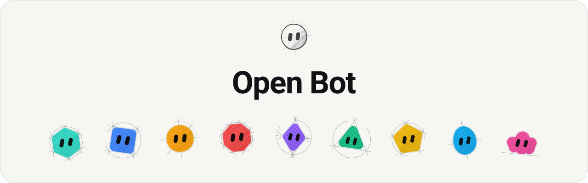
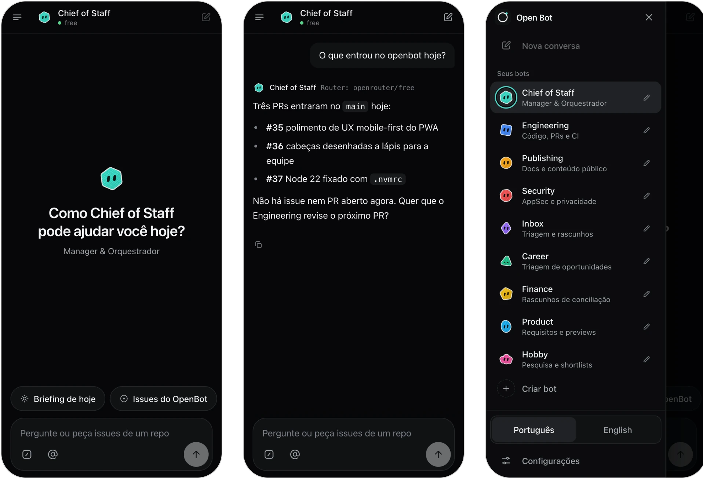
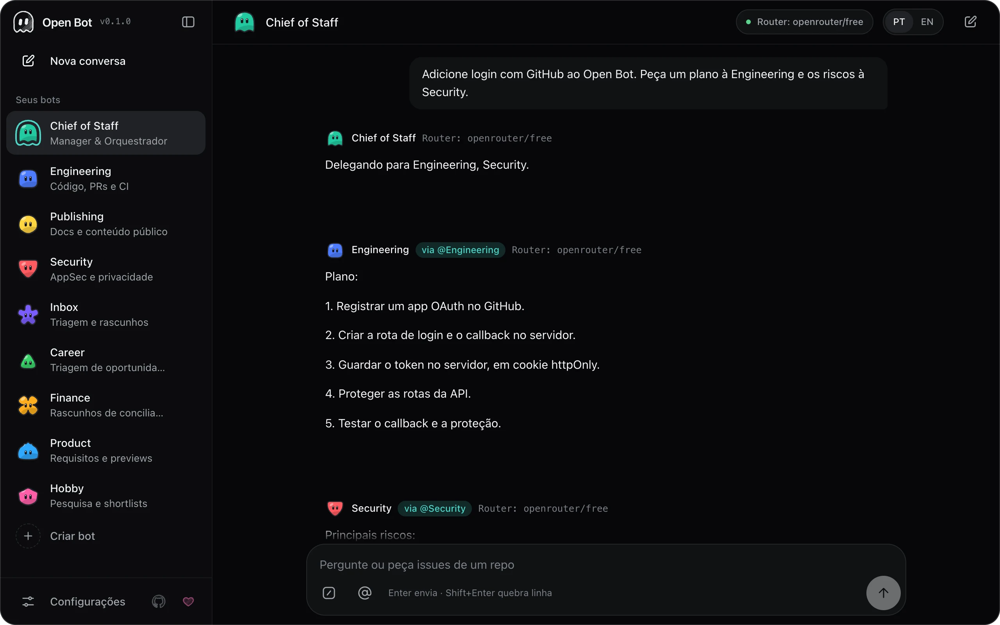

<picture>
  <source media="(prefers-color-scheme: dark)" srcset="docs/assets/readme/banner-dark.svg">
  
</picture>

# Open Bot

> Uma equipe de bots de IA que mora no seu celular. Um Chief of Staff lidera e delega, você escolhe o modelo e as chaves de API ficam no seu próprio servidor.

[English](README.md) · [Español](README.es.md) · [Por onde começar](#por-onde-começar) · [Telas](#como-ele-é) · [A equipe](#a-equipe) · [Modelos](#escolha-o-modelo) · [Instale no celular](#instale-no-celular) · [Status](#status-e-limites)

<picture>
  <source media="(prefers-color-scheme: dark)" srcset="docs/assets/readme/architecture-dark.svg">
  
</picture>

O app no navegador fala só com o seu servidor. O servidor guarda as chaves e chama o modelo e o GitHub.

## Por onde começar

1. Selecione o Node.js 24 do `.nvmrc` com `nvm use` (Node.js 24.15.0 ou mais novo, a linha LTS com o módulo SQLite embutido).
2. Instale as dependências e os hooks do Git com `npm ci`.
3. Copie `.env.example` para `.env.local` e preencha um provedor. Você pode pular este passo e escolher o modelo depois, em Configurações.
4. Rode `npm run dev` e abra `http://localhost:3000`.

## Como ele é

No celular, a lista de bots é uma gaveta e o campo de mensagem fica ao alcance do polegar. A partir da largura de tablet, ela vira uma barra lateral que você pode recolher.

## A equipe

Cada bot tem a própria conversa, prompt, avatar e skills. Trocar de bot troca a conversa, e cada histórico fica neste aparelho. Digite `@` para passar uma mensagem a outro bot e `/` para rodar uma das suas skills.

O Open Bot começa com uma equipe de nove. O prompt de cada um pede sua aprovação explícita antes de qualquer alteração externa.

| Bot            | Cuida de                                                          |
| -------------- | ----------------------------------------------------------------- |
| Chief of Staff | Planeja, resume e delega aos outros. É o bot principal no início. |
| Engineering    | Código, pull requests e CI                                        |
| Publishing     | Docs e conteúdo público                                           |
| Security       | AppSec e privacidade                                              |
| Inbox          | Triagem e rascunhos                                               |
| Career         | Triagem de oportunidades                                          |
| Finance        | Rascunhos de conciliação                                          |
| Product        | Requisitos e previews                                             |
| Hobby          | Pesquisa e shortlists                                             |

Você pode editar qualquer um deles ou criar o seu, do zero ou a partir de um modelo: Architect, Code Reviewer, AppSec Lead, Platform Engineer, Technical Writer ou Bug Hunter.

### O bot principal lidera

Um bot é o principal. Ele faz o papel de Chief of Staff: fica no topo da lista, conhece todos os outros bots e não pode ser excluído. Qualquer bot pode assumir o papel: abra o bot, escolha Tornar principal e a equipe passa a segui-lo. Nada na equipe é fixo. O Chief lê os bots que você tem, as funções e as skills deles, a cada mensagem que você envia.

### Como a delegação funciona

<picture>
  <source media="(prefers-color-scheme: dark)" srcset="docs/assets/readme/delegation-dark.svg">
  
</picture>

Peça ao Chief algo que precise de mais de um especialista e ele escreve uma linha `@delegar` por tarefa. Cada especialista responde na sua vez, com o próprio nome e avatar, e depois o Chief escreve um resumo só para você.

- No máximo três delegações por mensagem, respondidas uma após a outra, para não sobrecarregar os modelos gratuitos.
- Um salto só. Um especialista nunca delega de novo, então não há ciclos.
- Nomes que o Chief inventa, ele mesmo e repetições são descartados. Um especialista que falha não quebra a resposta.
- Você ainda pode falar com qualquer bot direto, ou passar uma mensagem avulsa com `@`.

## O que ele faz hoje

| Recurso                | Como funciona                                                                                                                                                                                                          |
| ---------------------- | ---------------------------------------------------------------------------------------------------------------------------------------------------------------------------------------------------------------------- |
| Conversa com um modelo | O servidor chama o provedor que você configurou. Veja [Escolha o modelo](#escolha-o-modelo).                                                                                                                           |
| Issues e PRs do GitHub | Peça `dono/repo` ou cole um link do GitHub. Repositórios públicos funcionam sem token. Para os privados, conecte o GitHub em Configurações, na aba Conexões, ou defina `GITHUB_TOKEN` no `.env.local`.                 |
| Briefing               | Resume dados reais do repositório. Sem modelo, monta o resumo com os mesmos dados.                                                                                                                                     |
| Delegação              | O bot principal passa trabalho aos seus outros bots e traz um resumo só. Veja [Como a delegação funciona](#como-a-delegação-funciona).                                                                                 |
| Failover               | Quando o modelo do router falha, o servidor tenta uma vez um modelo reserva, por padrão um modelo gratuito do OpenRouter, e a resposta mostra a troca.                                                                 |
| Fila de mensagens      | O que você envia enquanto um bot responde espera a vez, na ordem.                                                                                                                                                      |
| Skills                 | Cada bot guarda as próprias skills. Escreva uma ao editar o bot, ou cole um `SKILL.md`, e rode como `/comando`.                                                                                                        |
| Bot como arquivo       | Exporte um bot para um arquivo JSON com nome, instruções, visual e skills, e preencha o formulário de um bot novo com um arquivo. Conversas, chaves e senha não vão no arquivo, e as skills importadas ficam marcadas. |
| Bloqueio local         | Senha opcional que bloqueia o app neste aparelho. É um bloqueio de tela, não autenticação; só um hash PBKDF2 fica salvo.                                                                                               |
| Três idiomas           | Português brasileiro, inglês e espanhol, com troca a qualquer momento.                                                                                                                                                 |

## Escolha o modelo

| Provedor  | Variáveis no `.env.local`                               | Observações                                                                                                                                                       |
| --------- | ------------------------------------------------------- | ----------------------------------------------------------------------------------------------------------------------------------------------------------------- |
| Router    | `ROUTER_URL`, `ROUTER_MODEL`, `ROUTER_API_KEY` opcional | Qualquer endpoint compatível com OpenAI, como OpenRouter, 9Router ou OmniRoute. Configurações lista os modelos gratuitos do OpenRouter que a sua chave pode usar. |
| Local     | `LOCAL_MODEL_URL`, `LOCAL_MODEL_NAME`                   | Um servidor `/api/chat` compatível com Ollama, rodando na sua máquina.                                                                                            |
| Anthropic | `ANTHROPIC_API_KEY`, `ANTHROPIC_MODEL`                  | Uso pago da API.                                                                                                                                                  |

As variáveis do `.env.local` ficam no servidor. Nunca use o prefixo `NEXT_PUBLIC_`, que as envia para o navegador.

Cada bot também pode ter o próprio id de modelo (no formulário de edição do bot; vazio usa o modelo global). O servidor pode limitar os ids aceitos:

| Variável                 | Efeito                                                                                                                                                         |
| ------------------------ | -------------------------------------------------------------------------------------------------------------------------------------------------------------- |
| `OPENBOT_ALLOWED_MODELS` | Opcional, separada por vírgulas. Quando definida, um id de modelo de bot fora da lista recebe `400 model_not_allowed`. Sem ela, qualquer id bem formado passa. |

Você também pode escolher o provedor em Configurações, na aba Modelo. As chaves ficam na aba Conexões: cada serviço tem a sua, testada antes de ser salva. Essa escolha tem prioridade sobre o `.env.local`. Ela fica salva no `localStorage` deste navegador e vai para o seu servidor a cada mensagem; num aparelho compartilhado, prefira guardar as chaves no `.env.local`.

## Instale no celular

1. Gere e sirva o app de produção: `npm run build` e depois `npm start`. O service worker só é registrado no build de produção.
2. Abra o app no celular por HTTPS. Os navegadores só instalam apps servidos por HTTPS, ou por `localhost` na mesma máquina.

`npm run dev` e `npm start` escutam só nesta máquina (`127.0.0.1`), então o celular chega ao app por um proxy reverso ou túnel HTTPS rodando aqui. Para que outros aparelhos se conectem direto ao servidor, defina `OPENBOT_ACCESS_TOKEN` e rode `npm start -- -H 0.0.0.0`. 3. No iPhone, abra no Safari e toque em Compartilhar, depois em Adicionar à Tela de Início. No Android, abra no Chrome e escolha Instalar app no menu.

O service worker guarda só a casca do app. Ele nunca guarda chamadas a `/api`, respostas do modelo ou credenciais.

Por padrão o servidor não tem login, o que serve para localhost. Toda chamada a `/api` é checada por um `Origin` do mesmo site (ou pelo header `x-openbot-client: 1`), limitada a 64 KB e a 60 requisições por minuto por chamador (`OPENBOT_RATE_LIMIT`). Para expor além da sua máquina, defina `OPENBOT_ACCESS_TOKEN` no `.env.local`: toda chamada a `/api` passa a exigir `Authorization: Bearer <token>`. No navegador, salve o token uma vez com `localStorage.setItem("openbot_access_token", "<token>")` no console do desenvolvedor. Mantenha atrás de HTTPS e de um controle de acesso em que você confie.

Estas variáveis ajustam a proteção de `/api`. Defina no `.env.local`:

| Variável                     | Efeito                                                                                                                                                                                                                                                                                                                                                                                                                              |
| ---------------------------- | ----------------------------------------------------------------------------------------------------------------------------------------------------------------------------------------------------------------------------------------------------------------------------------------------------------------------------------------------------------------------------------------------------------------------------------- |
| `OPENBOT_RATE_LIMIT`         | Requisições por minuto por chamador (padrão 60).                                                                                                                                                                                                                                                                                                                                                                                    |
| `OPENBOT_TRUST_PROXY`        | Use `1` só atrás de um proxy reverso seu, que sempre define ou acrescenta `X-Forwarded-For` e é a única entrada. O chamador passa a ser o último valor desse header. Sem ela (padrão), todos os chamadores dividem um único balde do limite de requisições e um único conjunto de vagas de stream, porque o Next não expõe um endereço de origem que o chamador não possa forjar. Serve para uma pessoa, aperta demais para muitas. |
| `OPENBOT_STREAMS_PER_CLIENT` | Respostas em streaming que um chamador pode ter abertas ao mesmo tempo (padrão 4). Acima disso, `/api/chat/stream` responde `429 too_many_streams`.                                                                                                                                                                                                                                                                                 |
| `OPENBOT_STREAMS_GLOBAL`     | Respostas em streaming abertas ao mesmo tempo em todo o servidor (padrão 20).                                                                                                                                                                                                                                                                                                                                                       |

Uma única resposta também é limitada a 200.000 caracteres. Passando disso, ela é cortada e o chat avisa.

## Status e limites

O Open Bot é um projeto inicial, na versão 0.1.0.

- Os testes automatizados usam provedores simulados. Nenhum teste roda contra um modelo de verdade.
- A instalação num iPhone ou Android físico ainda não foi verificada.
- Bots, conversas, skills e Configurações ficam no `localStorage` deste navegador. Não há sincronização, mas você pode exportar e importar um arquivo de backup em Configurações (ele deixa de fora chaves, tokens e senhas).
- As descrições da equipe ainda estão só em português, mesmo com a interface em inglês ou espanhol.
- A delegação só rodou à mão contra um modelo gratuito. Nenhum teste automatizado chama um modelo real.
- Ainda não existe integração com calendário.

O [roadmap](docs/roadmap/roadmap.pt-BR.md) e o [plano de entrega para devs](docs/roadmap/developer-first.md) mostram o que vem a seguir.

## Desenvolvimento

O `npm ci` instala os hooks do Husky. O pre-commit formata e aplica lint aos arquivos staged. O pre-push e o CI rodam `npm run check`: checagem de documentos, Prettier, ESLint, `tsc`, testes e o build de produção. Leia o [CONTRIBUTING.md](CONTRIBUTING.md) antes de abrir um pull request.

| Leia                                         | Para                                                          |
| -------------------------------------------- | ------------------------------------------------------------- |
| [Arquitetura](docs/architecture/README.md)   | Camadas, Dependency Rule, portas de entrega e o escopo do MVP |
| [Candidatos de stack](docs/stacks/README.md) | A primeira spike e a escolha do kit de UI                     |
| [DESIGN.md](DESIGN.md)                       | Cor, tipografia, áreas de toque, movimento e voz              |
| [Harness](docs/harness/README.md)            | Guias, sensores e limites dos agentes                         |
| [Convenções de Git](docs/git-conventions.md) | Commits, branches e pull requests                             |

## Por que o Open Bot

O Open Bot nasceu de uma dor conhecida: o Grok Bot ficou caro demais para um brasileiro duro que queria um agente pessoal. A ideia é algo acessível, aberto a contribuições e livre para rodar com um modelo local ou com a chave do provedor que você escolher. Ele aproveita os papéis, limites e padrões de aprovação do [grok-bot-architecture](https://github.com/tiagovilasboas/grok-bot-architecture).

## O que este repositório não carrega

- Uma instância hospedada ou cadastro. Você roda o seu próprio servidor.
- Modelos ou chaves de API. Você traz os seus.
- Sincronização entre aparelhos.
- Qualquer vínculo com o Grok Bot. O Open Bot é um projeto independente.

## Licença

O Open Bot é open source, sob a [licença MIT](LICENSE).

## Apoie o projeto

O Open Bot é mantido por Tiago Vilas Boas. Para apoiar seu desenvolvimento, [patrocine pelo GitHub Sponsors](https://github.com/sponsors/tiagovilasboas). O apoio é opcional; contribuições, sugestões e relatos de problemas também são bem-vindos.
