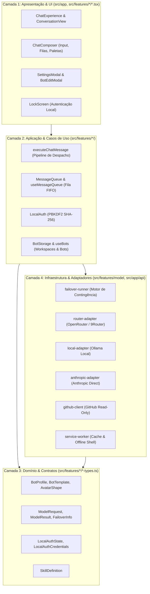

# Arquitetura e Camadas do OpenBot PWA

Este documento define a arquitetura em camadas do OpenBot PWA (`tiagovilasboas/openbot`), fundamentada em **Screaming Architecture**, **Dependency Rule**, **Clean Code** e **SRP**.

---

## 1. Visão Geral e Princípios Fundamentais

1. **Screaming Architecture:** A estrutura do projeto reflete o domínio do negócio (`src/features/chat`, `src/features/bots`, `src/features/model`, `src/features/auth`, `src/features/skills`, `src/features/github`), não detalhes de framework.
2. **Dependency Rule:** As dependências apontam para dentro. A camada de domínio não depende de UI, Next.js ou adaptadores externos.
3. **Offline-First & Local-First:** Os dados, workspaces, histórico de mensagens e credenciais residem e são computados na máquina do usuário via Web Crypto e Storage local.
4. **Resiliência por Design (Failover):** Chamadas a modelos de IA são isoladas atrás de contratos tipados com capacidade de failover automático na infraestrutura.

---

## 2. Mapa de Camadas

---

## 3. Detalhamento das 4 Camadas

### Camada 1: Apresentação (UI Layer)

- **Localização:** `src/app/` e componentes `.tsx` em `src/features/`.
- **Responsabilidade:** Renderização da interface com Next.js 16 (App Router), React 19, HeroUI React e Tailwind CSS v4.
- **Regras:**
  - Componentes são focados (SRP) e limitados a ~300 linhas por arquivo.
  - O estado visual é desacoplado da lógica de transporte e criptografia.

### Camada 2: Aplicação (Application / Use Cases Layer)

- **Localização:** Hooks e orquestradores em `src/features/`.
- **Responsabilidade:** Coordenação das regras de negócio e fluxos do usuário.
- **Principais Serviços:**
  - `executeChatMessage`: Avalia o texto, resolve delegação `@bot`, detecta resumos factuais, lê GitHub ou despacha ao modelo.
  - `useMessageQueue`: Gerencia a fila FIFO quando o usuário submete tarefas durante processamento ativo.
  - `local-auth.ts`: Implementa criptografia de senha via PBKDF2 (100.000 iterações, 16-byte random salt, constant-time compare).

### Camada 3: Domínio (Domain Layer)

- **Localização:** `*-types.ts`, `bot-templates.ts` e arquivos de contrato puro.
- **Responsabilidade:** Entidades canônicas, invariantes de dados e validações independentes de ambiente.
- **Entidades Centrais:**
  - `BotProfile`: Entidade de agente com identidade, avatar procedural, skills e workspace context.
  - `ModelRequest` / `ModelResult`: Contratos padronizados de entrada e resposta de inferência.

### Camada 4: Infraestrutura & Adaptadores (Infrastructure Layer)

- **Localização:** Adaptadores de rede em `src/features/model/`, rotas de API em `src/app/api/` e Service Worker `public/sw.js`.
- **Responsabilidade:** Comunicação externa e persistência de baixo nível.
- **Garantias:**
  - Failover automático: se o provedor primário rejeitar por HTTP 429 ou 5xx, o `failover-runner` chaveia para o modelo de contingência sem interrupção para o usuário.
