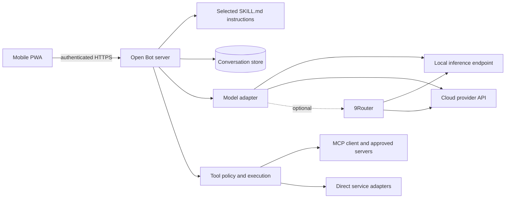

# MVP architecture proposal

Status: proposed, not implemented or validated. The initial target is one person using a phone and a computer on a trusted private network. A Next.js Node server serves a mobile PWA and the agent API; an inference server is a separate process when a local model is selected. Cloud model APIs remain available without local inference. A hosted always-on deployment is a later decision.

## Responsibility boundaries

- **Conversation:** accepts a request, stores messages and delivers a streamed response. UI components do not hold provider credentials.
- **Agent runtime:** selects applicable instructions, provides only allowed tool descriptions, requests model output and validates tool arguments before invoking the tool executor. Limit iterations and report failure instead of pretending a task succeeded.
- **Skills:** reusable instructions, selected deliberately and loaded on demand. A skill is neither a permission grant nor model training. Third-party skills and tool results are untrusted content.
- **Models:** an internal conversation/tool contract isolates provider adapters. Start with a local endpoint and Anthropic API; an OpenAI-compatible endpoint can support a separately configured 9Router. Capabilities, streaming, tool calls and errors differ; test each adapter. Explicit user selection controls provider and model. Do not silently send local conversations to a cloud fallback.
- **Tools and connectors:** a policy checks identity, tool allowlists, scopes and arguments before every invocation. MCP is one adapter; direct service API adapters are another. Start with read-only GitHub and calendar actions. External writes require a persisted, explicit user approval tied to the proposed operation and arguments.
- **Data and secrets:** SQLite is a candidate for conversations and settings, not a blanket solution for secret storage. Credentials stay server-side in a protected store; never put them in browser bundles, prompts, logs, or the repository. Define backup, deletion and revocation when implementing.

## Transport and operation

Next.js route handlers can expose chat and connection endpoints. Run a persistent Node deployment to support MCP client lifetimes; do not assume a serverless host provides durable processes. An installable PWA needs secure context: provide authenticated HTTPS reachable by the phone, including on the local network. `localhost` on the phone is the phone, not the Mac. Design pairing, certificate trust, session expiry and origin checks before exposing the service. [Next.js route handlers](https://nextjs.org/docs/app/getting-started/route-handlers) · [MCP security best practices](https://modelcontextprotocol.io/specification/2025-06-18/basic/security_best_practices).

## Reliability and evidence

Model timeouts, disconnects, invalid calls, denied permissions and unavailable services should produce visible errors and never silently perform writes. Record provider/model, timing, status, tool names and available token counts without logging secrets or private content by default. Accuracy, latency and cost are unknown until measured. Long-running jobs, background routines, multi-user hosting, native app packaging and voice are outside the first milestone.

## Relationship to the reference architecture

[grok-bot-architecture](https://github.com/tiagovilasboas/grok-bot-architecture) supplies patterns for role boundaries, reusable skills and human approval. The MVP begins with one agent; it does not claim to implement the full crew, board, handoff or cloud-agent architecture.
