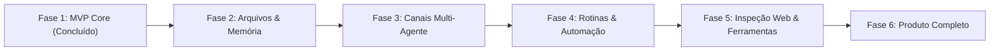

# Roadmap Master: Do MVP ao Produto Completo (OpenBot PWA)

Este documento define o roadmap executivo completo do **OpenBot PWA** para atingir paridade total com os recursos do `openbot.run` (`nightly-labs/openbot`), mantendo nossa arquitetura web ultra-leve, 100% offline-first e privada.

---

## 1. Visão Geral das 6 Fases de Entrega

| Fase       | Foco Estratégico                                |   Pontos   |       Status       |
| :--------- | :---------------------------------------------- | :--------: | :----------------: |
| **Fase 1** | **MVP Core & Resiliência Essencial**            |   21 pts   | **100% Concluído** |
| **Fase 2** | **Soberania de Contexto & Gestão de Arquivos**  |   18 pts   |  **Próxima Fase**  |
| **Fase 3** | **Canais de Equipe & Colaboração Multi-Agente** |   11 pts   |     Planejado      |
| **Fase 4** | **Rotinas Silenciosas & Loopback Automation**   |   13 pts   |     Planejado      |
| **Fase 5** | **Inspeção Web & Ferramentas Headless**         |   10 pts   |     Planejado      |
| **Fase 6** | **Polimento de Produto, Temas & Exportação**    |   8 pts    |     Planejado      |
| **Total**  | **Jornada Completa de Produto**                 | **81 pts** |  **26% Entregue**  |

---

## 2. Detalhamento por Fase e Tarefas

### Fase 1: MVP Core & Resiliência Essencial (21 pts — Concluído)

- **FEAT-01: Autenticação Local Offline (3 pts):** Criptografia PBKDF2 (SHA-256 com 100k iterações e salt aleatório), tela de bloqueio e aba de segurança.
- **FEAT-02: Roteador Dinâmico OpenRouter Free (3 pts):** Rota `/api/model/free` com cache de 5min e coleta em tempo real dos modelos `:free`.
- **FEAT-03: Provider Failover Engine (5 pts):** Comutação automática de contingência sob HTTP 429/5xx e badge visual no chat.
- **FEAT-04: Fila FIFO Não-Bloqueante (3 pts):** Submissão contínua com bot ocupado e indicador `X na fila`.
- **FEAT-05: Arquétipos de Bots (3 pts):** 6 templates de engenharia aplicáveis em 1 clique no modal de criação.
- **FEAT-06: Workspace Context por Bot (2 pts):** Diretrizes de projeto persistidas e injetadas no prompt de sistema.
- **FEAT-07: Purificação de Mocks (2 pts):** Remoção de simuladores e sandbox, delegação direta a modelos reais.

---

### Fase 2: Soberania de Contexto & Gestão de Arquivos (18 pts — Próxima)

_Especificação completa em [spec-workspaces-files.md](../specs/spec-workspaces-files.md) e [spec-context-compaction.md](../specs/spec-context-compaction.md)._

- [ ] **TASK-F2.1 (2 pts):** Input de anexo e componente `FileAttachmentPill` no `ChatComposer.tsx`.
- [ ] **TASK-F2.2 (2 pts):** Handler de drag-and-drop global de arquivos com overlay visual.
- [ ] **TASK-F2.3 (3 pts):** Persistência de arquivos de workspace no `IndexedDB` local.
- [ ] **TASK-F2.4 (3 pts):** Renderizador de anexos colapsáveis no balão de mensagem (`ChatMessageItem.tsx`).
- [ ] **TASK-F2.5 (3 pts):** Monitor de tokens em tempo real e cálculo da janela de contexto (`calculateContextBudget`).
- [ ] **TASK-F2.6 (3 pts):** Algoritmo de Auto-Compaction de turnos antigos em bloco de memória consolidada.
- [ ] **TASK-F2.7 (2 pts):** Validação de instalação PWA real no iOS e Android via HTTPS local.

---

### Fase 3: Canais de Equipe & Colaboração Multi-Agente (11 pts)

_Especificação completa em [spec-multi-agent-channels.md](../specs/spec-multi-agent-channels.md)._

- [ ] **TASK-F3.1 (3 pts):** Estrutura e armazenamento de canais compartilhados (`channel-storage.ts`).
- [ ] **TASK-F3.2 (3 pts):** UI de canais temáticos (`#canal`) no `ChatSidebar.tsx`.
- [ ] **TASK-F3.3 (2 pts):** Barra superior de controle de `TaskOwner` (Pausar, Reatribuir, Concluir).
- [ ] **TASK-F3.4 (3 pts):** Sensor computacional e prompt de proteção anti-looping entre bots.

---

### Fase 4: Rotinas Silenciosas & Loopback Automation (13 pts)

_Especificação completa em [spec-background-routines.md](../specs/spec-background-routines.md)._

- [ ] **TASK-F4.1 (3 pts):** Agendador em Web Worker para tarefas periódicas em segundo plano.
- [ ] **TASK-F4.2 (2 pts):** Tratamento do marcador `[[no-update]]` e supressão de notificações em execuções silenciosas.
- [ ] **TASK-F4.3 (3 pts):** Interface de criação e pausa de rotinas no `BotEditModal.tsx`.
- [ ] **TASK-F4.4 (2 pts):** Alerta visual e comutação para `failed` em falhas (`routine_report_failure`).
- [ ] **TASK-F4.5 (3 pts):** Listener HTTP loopback em `127.0.0.1` com token bearer e trava de 30 runs/hora.

---

### Fase 5: Inspeção Web & Ferramentas Headless (10 pts)

_Especificação completa em [spec-browser-tools.md](../specs/spec-browser-tools.md)._

- [ ] **TASK-F5.1 (3 pts):** Endpoint de extração segura de páginas web em Markdown (`/api/web/extract`).
- [ ] **TASK-F5.2 (2 pts):** Ferramenta autônoma `fetch_url_content` para bots lerem links enviados no chat.
- [ ] **TASK-F5.3 (5 pts):** Adaptador de inspeção headless CDP porta 9222 sob estrito guardrail de zero janelas paralelas.

---

### Fase 6: Polimento de Produto, Temas & Exportação (8 pts)

- [ ] **TASK-F6.1 (3 pts):** Exportação completa de dados locais em JSON/ZIP criptografado para backup.
- [ ] **TASK-F6.2 (3 pts):** Suporte a paletas de temas customizadas (`themes/<nome>.json`), mantendo o padrão dark true-black.
- [ ] **TASK-F6.3 (2 pts):** Auditoria de acessibilidade e conformidade total com WCAG AA.
